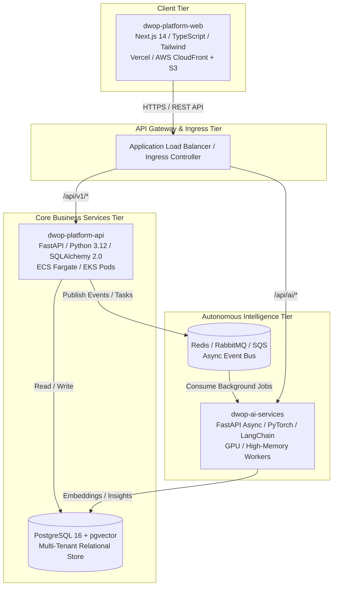
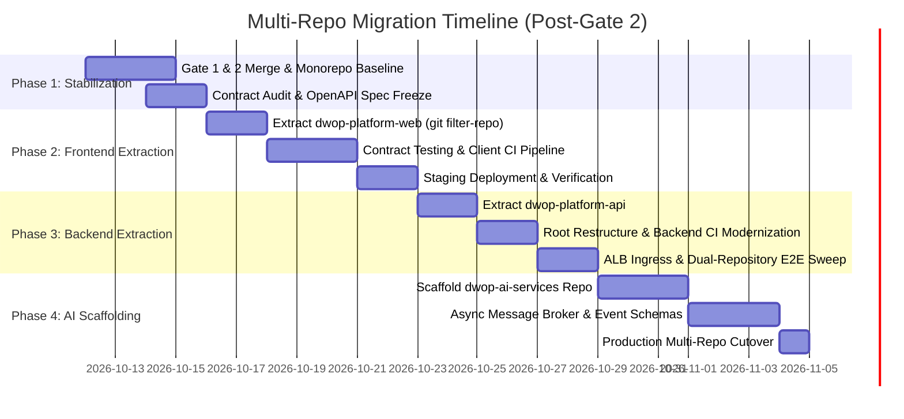
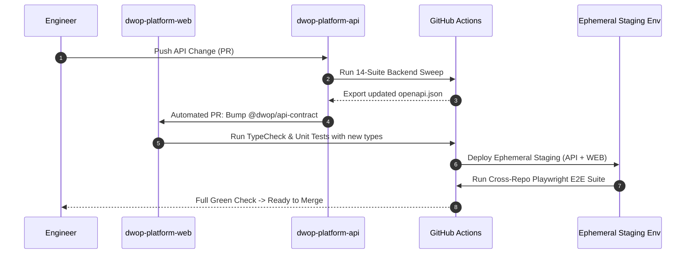

# Multi-Repository Migration Roadmap: Decomposing the DWOP Monorepo

**Document Version**: 1.0  
**Status**: Proposal / Strategic Planning (Deferred Execution per CTO Directive)  
**Date**: 2026-10-09  
**Target Execution Gate**: Post-Gate 2 Operational Clearance  
**Author**: AZM Nexus Platform & Backend Engineering  
**Sponsor**: Mr. Sadiq, Chief Technology Officer  
**Reviewers**: Khalifa (@KHALIFAH334, Senior Reviewer), Walid (@LawdeWayde, Operations Lead)  

---

## 1. Executive Summary & Strategic Rationale

During Sprint 0 through Gate 2, the **DWOP unified monorepo** (`dwop-platform`) provided essential velocity: unified atomic commits across full-stack features, zero-latency REST contract adjustments, and shared dependency synchronization across 14 platform test suites.

However, as the platform transitions toward enterprise scalability (targeting 1,000+ concurrent active users per ADR-001/002) and prepares for parallelized feature development (Track A workforce/client workflows alongside autonomous AI matching and ingestion engines), the monorepo introduces operational bottlenecks:

1. **Coupled Release Lifecycles**: Frontend UI changes currently require traversing backend CI verification, and backend security patches trigger frontend re-builds, inflating CI pipeline duration.
2. **Disparate Technology Lifecycles**: The Next.js 14 client runtime, FastAPI Python service layer, and emerging GPU/CPU-intensive AI worker microservices possess completely different dependency topologies, deployment targets, and auto-scaling profiles.
3. **Team Lane Contention**: Multiple engineering leads (Dotun on Integrations/QA, Usman on Activity/Settings, Walid on Core Operations, Khalifa on Architecture/Security) working in the same branch tree risk merge collisions and conflicting deployment trains.

Per CTO Directive, execution of the split is **deferred until Gate 2 sign-off is complete** to guarantee operational stability. This roadmap establishes the phased, zero-downtime strategy to extract the monorepo into three domain-bounded repositories without interrupting active Track A feature delivery.

---

## 2. Target Repository Topology



### 2.1 Repository Boundary Specifications

| Repository Name | Core Responsibilities & Scope | Technology Stack | Deployment Target |
|---|---|---|---|
| **`dwop-platform-api`** | Core transactional domain models, multi-tenant persistence, stateless RBAC policy engine (`app/core/policy.py`), 10 domain REST routers, 8 repositories, 6 services, and audit timeline ledger. | Python 3.12, FastAPI, SQLAlchemy 2.0, Alembic, Pydantic v2 | AWS ECS Fargate / EKS behind ALB |
| **`dwop-platform-web`** | Enterprise workforce experience, responsive UI pages (`/workforce`, `/onboarding`, `/assignments`, `/access`), design token system, client-side AuthContext, and RBAC-aware navigation. | Next.js 14 (App Router), React 18, TypeScript, TailwindCSS, Lucide | Vercel Enterprise / AWS CloudFront + S3 / ECS |
| **`dwop-ai-services`** | Autonomous talent-project matching algorithms, resume/contract extraction pipelines, predictive capacity forecasting, and automated onboarding copilot agents. | Python 3.12, FastAPI Async Workers, Celery/FastStream, PyTorch, OpenAI/HuggingFace SDKs | AWS ECS (GPU-accelerated or High-Memory compute) |

---

## 3. Four-Phase Migration Execution Plan



### Phase 1: Monorepo Stabilization & Dependency Mapping

**Objective**: Establish a frozen baseline, eliminate hidden cross-directory coupling, and publish a machine-enforceable API contract.

1. **Pre-Split Convergence**:
   - Merge PR #11 (Task P-08: Dependency Injection & Gate-1 Architectural Closeout) and PR #13 (Gate 2: Tasks O-01 & O-02 Stateless RBAC Engine).
   - Ensure all 14 platform regression test suites and `frontend` build pass with zero warnings.
2. **Coupling Audit**:
   - Verify zero shared code between `backend/` and `frontend/`. Confirm the boundary is strictly HTTP/JSON over REST.
   - Extract hardcoded configuration strings and environment variables into formalized `.env.example` templates.
3. **OpenAPI Specification Publication**:
   - Automate OpenAPI JSON extraction from FastAPI via `python backend/scripts/export_openapi.py`.
   - Setup `@openapitools/openapi-generator-cli` or `openapi-typescript` to generate strict TypeScript interfaces for all DTOs and responses (`TokenResponse`, `PolicyResponse`, `UserRead`, `ProfessionalRead`, etc.).

---

### Phase 2: Extraction of the Next.js Frontend (`dwop-platform-web`)

**Objective**: Spin off the user interface into an independent repository while preserving full git commit history and ensuring zero client-side degradation.

1. **Git Subtree / Filter Extraction**:
   - Use `git-filter-repo` to extract the `frontend/` directory into a new standalone repository `azmnexus/dwop-platform-web`, retaining all commit contributions from mubus133, only1dfs, and LawdeWayde.
   ```bash
   git clone https://github.com/azmnexus/dwop-platform.git dwop-platform-web-extract
   cd dwop-platform-web-extract
   git filter-repo --subdirectory-filter frontend
   git remote add origin https://github.com/azmnexus/dwop-platform-web.git
   git push -u origin main development
   ```
2. **Contract Locking & Client Mock Server**:
   - Integrate MSW (Mock Service Worker) driven by the published OpenAPI spec to allow frontend engineers to develop against locked contracts even if backend endpoints undergo internal refactoring.
3. **Frontend CI/CD Architecture**:
   - Setup GitHub Actions workflow validating:
     - ESLint + Prettier code formatting.
     - `tsc --noEmit` strict TypeScript compilation.
     - `next build` static export and route trace verification.
     - Headless Cypress / Playwright E2E smoke tests against a mock or staging backend container.
4. **Staging Environment Binding**:
   - Configure preview environments (e.g., Vercel Preview Deployments or AWS Amplify) parameterized by `NEXT_PUBLIC_API_URL` pointing to the deployed staging API.

---

### Phase 3: Extraction of the FastAPI Backend (`dwop-platform-api`)

**Objective**: Promote the backend service into the primary core API repository, restructuring root paths and streamlining Docker builds.

1. **Repository Repositioning**:
   - The original `azmnexus/dwop-platform` will be renamed to `azmnexus/dwop-platform-api` (or extracted via `git-filter-repo --subdirectory-filter backend` plus `docs/`).
   - Elevate `backend/*` to the repository root (`app/`, `alembic/`, `scripts/`, `pyproject.toml`, `requirements.txt`).
2. **Root Configuration & Script Normalization**:
   - Update `alembic.ini` to reference root paths (`script_location = alembic`).
   - Remove redundant `$env:PYTHONPATH="backend"` requirements; standard Python execution from repo root will resolve `app` natively.
3. **CI/CD Pipeline Streamlining**:
   - Dedicated backend GitHub Actions workflow:
     - Python 3.12 matrix setup with cached `pip` virtual environment.
     - Alembic migration test (`alembic upgrade head`, `alembic downgrade -1`, `alembic upgrade head`).
     - Sequential execution of all 14 regression test suites (`test_default_github_integration_seed.py` through `test_dwop018_dependency_injection.py`).
     - Docker multi-stage build producing slim production container image (`python:3.12-slim`).
4. **API Gateway & Routing Alignment**:
   - AWS ALB or NGINX Ingress rules configured to route `/api/v1/*` traffic directly to `dwop-platform-api` target groups with health checks hitting `/api/v1/auth/policy` or dedicated `/healthz`.

---

### Phase 4: Scaffolding `dwop-ai-services`

**Objective**: Establish a specialized asynchronous repository for workforce intelligence, matching engines, and predictive analytics.

1. **Repository Initialization (`azmnexus/dwop-ai-services`)**:
   - Scaffolding with Python 3.12, FastAPI (for internal management/health), and Celery/FastStream for task consumption.
   - Poetry/uv for deterministic dependency management.
2. **Asynchronous Event-Driven Decoupling**:
   - `dwop-platform-api` acts as the system of record. When state changes occur (e.g., `professional.bulk_imported`, `assignments.allocated`), an event is published to Redis/RabbitMQ/SQS.
   - `dwop-ai-services` consumes events asynchronously, calculates vector embeddings, and writes recommendations back to `dwop-platform-api` via internal service-to-service REST/gRPC endpoints.
3. **Data Isolation Invariant**:
   - `dwop-ai-services` does **NOT** maintain direct write access to primary transactional tables. All persistent domain state transitions are mediated through `dwop-platform-api` domain endpoints to preserve database integrity and state machine guards.

---

## 4. CI/CD & Cross-Repository Integration Strategy



### 4.1 Schema Contract Verification (Consumer-Driven Contract Testing)
To eliminate breaking changes across repositories:
1. **Pact / Schemathesis Contract Validation**: `dwop-platform-api` runs Schemathesis fuzzing against its OpenAPI definition on every PR to verify status codes, payload shapes, and error formats.
2. **Automated SDK Bumping**: When `dwop-platform-api` merges a contract change to `development`, a GitHub Action generates updated TypeScript types and submits an automated PR to `dwop-platform-web`.
3. **SemVer API Versioning**: All endpoints remain strictly under `/api/v1`. Any non-backward-compatible contract change must be introduced under `/api/v2` with a deprecation schedule.

### 4.2 Ephemeral Preview Environments
- GitHub Actions dynamically deploys pull request branches of `dwop-platform-web` against the active `development` staging cluster of `dwop-platform-api`.
- Full end-to-end regression tests verify critical user journeys (login, workforce intake, onboarding checklist progression, access approval flow) before merging.

---

## 5. Risk Mitigation & Zero-Interruption Strategy for Track A

To prevent halting active Track A feature delivery (such as Usman's Activity/Settings workspaces or Dotun's Integrations extensions), the following safeguards are mandatory:

| Risk Scenario | Severity | Mitigation & Contingency Strategy |
|---|---|---|
| **Feature Freeze Bottleneck** | **High** | **Strangler Fig Migration**: Feature work continues in the monorepo during Phase 1. Repositories are split over a designated 48-hour weekend transition window post-Gate 2, preceded by rehearsals in staging forks. |
| **Commit History Loss** | **Medium** | **Strict `git-filter-repo` Usage**: Plain directory copy-pasting is strictly prohibited. Subtree filtering guarantees all blame history, PR commit messages, and author attributions remain intact across new repositories. |
| **API Contract Desynchronization** | **High** | **Automated Type Generation Gate**: PRs touching backend route contracts cannot merge without green verification from the generated frontend TypeScript contract consumer suite. |
| **Deployment Complexity Spike** | **Medium** | **Unified Terraform / Infrastructure-as-Code (IaC)**: Centralized IaC modules manage IAM roles, ALB listener rules, and environment secret synchronization across all three repositories identically. |
| **Rollback Need During Split** | **High** | **Dual-Remote Fallback Buffer**: The original monorepo will remain archived in read-only state for 30 days post-cutover. If critical defects emerge in the multi-repo orchestration, a branch mirror script allows rolling back to monorepo CI within 15 minutes. |

---

## 6. Migration Governance & Next Actions

1. **Prerequisite**: PR #11 (Gate 1 P-08 DI) and PR #13 (Gate 2 O-01/O-02 RBAC) merged into `development` under Khalifa's Senior Review.
2. **Review Action**: Mr. Sadiq review and approval of this architectural roadmap.
3. **Execution Window**: Scheduled for post-Gate 2 maintenance cycle, commencing with Phase 1 contract auditing.
