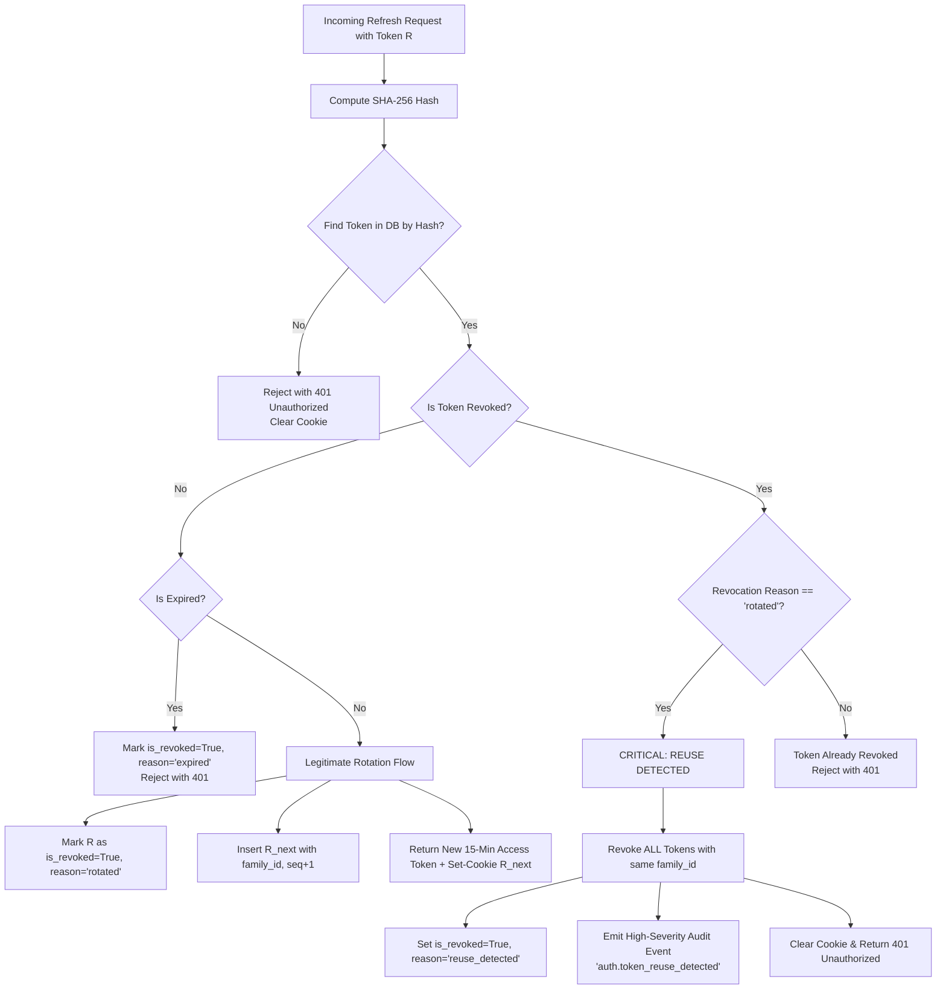

# Technical Specification: Advanced Token Lifecycle & Refresh Token Rotation

**Document Version**: 1.0  
**Status**: Proposal / Post-Gate 2 Technical Specification (Milestone O-05)  
**Date**: 2026-10-09  
**Governing ADR**: [`docs/adr-002-stateless-rbac-scaling.md`](../adr-002-stateless-rbac-scaling.md) (§4 & §4.3)  
**Author**: AZM Nexus Core Backend & Security Engineering  
**Sponsor**: Mr. Sadiq, Chief Technology Officer  
**Senior Reviewer**: Khalifa (@KHALIFAH334, Security & Architecture Lead)  

---

## 1. Executive Summary & Security Objectives

In **Gate 2 (Tasks O-01 & O-02)**, DWOP deployed a high-performance in-memory stateless RBAC policy engine (`backend/app/core/policy.py`) paired with a single-query hybrid offboarding guard (`UserRepository.get_lifecycle_flags`). Per CTO directive, Gate 2 retained 60-minute access token lifetimes without a `token_version` mechanism to preserve sub-millisecond evaluation speed and avoid stateful DB lookups on normal requests.

In [`docs/adr-002-stateless-rbac-scaling.md`](../adr-002-stateless-rbac-scaling.md), Section 4 explicitly documented the resulting **Temporary 60-Minute Privilege-Downgrade Exposure**: while account deactivations (`User.is_active = false`) and workspace suspensions (`Tenant.is_active = false`) revoke access instantly, an in-place role downgrade (e.g., `ADMIN` → `MEMBER`) allows an active token to assert the previous role until it reaches its 60-minute expiration.

This specification details **Milestone O-05 (Advanced Token Lifecycle & Refresh Token Rotation)**, which permanently closes this exposure window through a defense-in-depth architecture:

1. **Shortened Access Token Window (15 Minutes)**: Reduces the maximum privilege-downgrade window from 60 minutes to 15 minutes without introducing any per-request database lookups.
2. **Stateful, Cryptographically Hashed Refresh Tokens (7 Days)**: Stored server-side in PostgreSQL using high-entropy SHA-256 digests.
3. **Automatic Token Rotation with Family Lineage Tracking**: Every refresh operation invalidates the presented refresh token and issues a new successor in the same family.
4. **Immediate Reuse Detection & Family Revocation**: Replaying an already-consumed refresh token immediately triggers catastrophic invalidation of the entire token family, neutralizing token theft.
5. **Immediate Role Downgrade & Offboarding Invalidation**: Administrative role modifications immediately revoke all active refresh token families for the targeted user.

---

## 2. Token Topology & Architectural Flows

```mermaid
sequenceDiagram
    autonumber
    participant Client as Browser Client
    participant AuthAPI as POST /auth/refresh
    participant TokenSvc as RefreshTokenService
    participant DB as PostgreSQL (refresh_tokens)
    participant Policy as PolicyEngine

    Note over Client,Policy: Normal 15-Minute Silent Rotation Flow
    Client->>AuthAPI: POST /auth/refresh (Cookie: dwop_refresh_token, no body)
    AuthAPI->>TokenSvc: Validate and rotate refresh token
    TokenSvc->>TokenSvc: Compute SHA-256 hash of plaintext token
    TokenSvc->>DB: Query token by token_hash
    alt Token valid and unrevoked
        TokenSvc->>DB: Mark old token as is_revoked=True (reason='rotated')
        TokenSvc->>DB: Insert new token (same family_id, seq+1)
        TokenSvc->>Policy: Fetch fresh permissions & team lead scopes
        TokenSvc-->>AuthAPI: New Access Token (15 min) + New Refresh Token
        AuthAPI-->>Client: 200 OK (JSON: access_token; Set-Cookie: new dwop_refresh_token)
    else Token already marked 'rotated' (REUSE DETECTED)
        TokenSvc->>DB: Revoke ENTIRE family_id (is_revoked=True, reason='reuse_detected')
        TokenSvc->>DB: Emit audit event 'auth.token_reuse_detected'
        AuthAPI-->>Client: 401 Unauthorized (Clear dwop_refresh_token cookie)
        Note over Client: Forced Re-Authentication Required
    end
```

### 2.1 Token Pair Profile

| Token Class | Lifetime | Storage Location | Transport Medium | Security & Integrity Controls |
|---|---|---|---|---|
| **Access Token** | **15 minutes** | Memory only (React AuthContext / variable) | `Authorization: Bearer <JWT>` header | Cryptographically signed (HS256/RS256), embeds verified `role`, `tenant_id`, `perms`, `scopes`, `lead_teams`, `iss`, `aud`. **Zero DB lookups on request path.** |
| **Refresh Token** | **7 days** | Server: PostgreSQL (`refresh_tokens` table)<br/>Client: Browser Cookie Jar | `Set-Cookie: dwop_refresh_token` | High-entropy random hex (256-bit entropy). `HttpOnly`, `Secure`, `SameSite=Strict`, `Path=/api/v1/auth`. SHA-256 hashed in database. |

---

## 3. Database Schema: `refresh_tokens`

A dedicated PostgreSQL table tracks the complete lineage of issued refresh tokens. The plain-text token secret is **never stored**; only its SHA-256 digest is persisted.

### 3.1 Table Definition & Indexes

```sql
CREATE TABLE refresh_tokens (
    id UUID PRIMARY KEY DEFAULT gen_random_uuid(),
    user_id UUID NOT NULL REFERENCES users(id) ON DELETE CASCADE,
    tenant_id UUID NOT NULL REFERENCES tenants(id) ON DELETE CASCADE,
    token_hash VARCHAR(64) NOT NULL,
    family_id UUID NOT NULL,
    sequence_number INTEGER NOT NULL DEFAULT 1,
    parent_token_id UUID REFERENCES refresh_tokens(id) ON DELETE SET NULL,
    is_revoked BOOLEAN NOT NULL DEFAULT FALSE,
    revoked_at TIMESTAMP WITH TIME ZONE NULL,
    revocation_reason VARCHAR(100) NULL,
    device_fingerprint VARCHAR(255) NULL,
    client_ip VARCHAR(45) NOT NULL,
    user_agent TEXT NOT NULL,
    expires_at TIMESTAMP WITH TIME ZONE NOT NULL,
    created_at TIMESTAMP WITH TIME ZONE NOT NULL DEFAULT NOW()
);

-- Unique index ensuring rapid, indexed lookup and preventing hash collisions
CREATE UNIQUE INDEX uq_refresh_tokens_token_hash ON refresh_tokens(token_hash);

-- Performance indexes for family invalidation and user lifecycle cleanup
CREATE INDEX ix_refresh_tokens_family_id ON refresh_tokens(family_id);
CREATE INDEX ix_refresh_tokens_user_id_active ON refresh_tokens(user_id, is_revoked);
CREATE INDEX ix_refresh_tokens_expires_at ON refresh_tokens(expires_at);
```

### 3.2 SQLAlchemy Model Specification

```python
# backend/app/models/security.py
import uuid
from datetime import datetime, timezone
from sqlalchemy import Boolean, Column, DateTime, ForeignKey, Integer, String, Text
from sqlalchemy.dialects.postgresql import UUID
from sqlalchemy.orm import relationship
from app.core.database import Base


class RefreshToken(Base):
    __tablename__ = "refresh_tokens"

    id = Column(UUID(as_uuid=True), primary_key=True, default=uuid.uuid4)
    user_id = Column(UUID(as_uuid=True), ForeignKey("users.id", ondelete="CASCADE"), nullable=False, index=True)
    tenant_id = Column(UUID(as_uuid=True), ForeignKey("tenants.id", ondelete="CASCADE"), nullable=False, index=True)
    
    # SHA-256 digest of the plaintext cryptographically random token string
    token_hash = Column(String(64), unique=True, nullable=False, index=True)
    
    # Identifies the unbroken session lineage across rotations
    family_id = Column(UUID(as_uuid=True), nullable=False, index=True)
    sequence_number = Column(Integer, default=1, nullable=False)
    parent_token_id = Column(UUID(as_uuid=True), ForeignKey("refresh_tokens.id", ondelete="SET NULL"), nullable=True)
    
    is_revoked = Column(Boolean, default=False, nullable=False)
    revoked_at = Column(DateTime(timezone=True), nullable=True)
    revocation_reason = Column(String(100), nullable=True)
    
    # Client telemetry for anomaly detection
    device_fingerprint = Column(String(255), nullable=True)
    client_ip = Column(String(45), nullable=False)
    user_agent = Column(Text, nullable=False)
    
    expires_at = Column(DateTime(timezone=True), nullable=False, index=True)
    created_at = Column(DateTime(timezone=True), default=lambda: datetime.now(timezone.utc), nullable=False)

    # Relationships
    user = relationship("User", back_populates="refresh_tokens")
    tenant = relationship("Tenant")
```

---

## 4. Endpoint Specifications & Transport Security

### 4.1 Secure Cookie Configuration Standards
All refresh token cookies are dispatched with strict attributes adhering to OWASP Session Management Guidelines:

```python
# Cookie parameters in FastAPI response
response.set_cookie(
    key="dwop_refresh_token",
    value=plaintext_refresh_token,
    max_age=7 * 24 * 60 * 60,  # 7 days in seconds
    expires=7 * 24 * 60 * 60,
    path="/api/v1/auth",       # Scoped strictly to authentication paths
    domain=settings.COOKIE_DOMAIN,  # None in local dev, ".azm-nexus.com" in prod
    secure=settings.ENVIRONMENT != "development",  # Enforce HTTPS in production
    httponly=True,             # Inaccessible to document.cookie / XSS scripts
    samesite="Strict",         # Blocks CSRF on cross-origin requests
)
```

### 4.2 Endpoint Contract Adjustments

#### `POST /api/v1/auth/login`
- **Request**: Unchanged (`LoginRequest` with `email` and `password`).
- **Processing**:
  1. Validates credentials and verifies `user.is_active` and `user.tenant.is_active`.
  2. Generates a new `family_id = uuid.uuid4()`.
  3. Mints a 256-bit cryptographically secure random secret (`secrets.token_hex(32)`).
  4. Stores SHA-256 hash in `refresh_tokens`.
  5. Mints a **15-minute access token** carrying verified claims (`role`, `tenant_id`, `perms`, `scopes`, `lead_teams`).
- **Response**:
  - `Set-Cookie`: `dwop_refresh_token=<token_secret>; HttpOnly; Secure; SameSite=Strict; Path=/api/v1/auth`
  - Body (`TokenResponse`): Returns `access_token`, `expires_in: 900` (15 mins), user profile, permissions, and scopes.

#### `POST /api/v1/auth/refresh`
- **Request**: Reads `dwop_refresh_token` from incoming HTTP cookie header. No JSON body required.
- **Processing**:
  1. Computes SHA-256 hash of the presented token string.
  2. Executes **Reuse Detection & Rotation Algorithm** (see §5).
  3. Hydrates current `User` row: re-verifies `is_active` and `tenant.is_active`.
  4. Resolves fresh `POLICY_MATRIX` permissions and current `Team.team_lead_id` derived scopes.
  5. Mints fresh 15-minute access token and sets rotated refresh token cookie.
- **Response**:
  - `Set-Cookie`: New rotated `dwop_refresh_token`.
  - Body: New `access_token` and metadata.

#### `POST /api/v1/auth/logout`
- **Processing**:
  1. Locates active refresh token from cookie and marks `is_revoked = True` (`revocation_reason = 'logout'`).
  2. Executes `response.delete_cookie(key="dwop_refresh_token", path="/api/v1/auth")`.
  3. Emits audit event `auth.logout`.

---

## 5. Token Reuse Detection & Revocation Algorithm

When a refresh token is stolen (e.g., via network interception or physical machine compromise), both the legitimate user and the attacker may attempt to present it. Token rotation ensures that the first party to use token $R_1$ transitions the session to $R_2$. The second party attempting to use $R_1$ will present an already-consumed token.



### 5.1 Service Implementation Logic

```python
# backend/app/services/refresh_token.py
import hashlib
import secrets
import uuid
from datetime import datetime, timedelta, timezone
from sqlalchemy.orm import Session
from fastapi import HTTPException, status
from app.models.security import RefreshToken
from app.models.user import User
from app.core.policy import policy_engine
from app.core.scopes import ScopeResolver
from app.core.security import create_access_token


class RefreshTokenService:
    def __init__(self, db: Session):
        self.db = db

    @staticmethod
    def _hash_token(plaintext_token: str) -> str:
        return hashlib.sha256(plaintext_token.encode("utf-8")).hexdigest()

    def rotate_session(
        self,
        plaintext_token: str,
        client_ip: str,
        user_agent: str,
    ) -> tuple[str, str, User]:
        """Validate an incoming refresh token, detect reuse, and rotate atomically.
        
        Returns:
            tuple[new_access_token, new_plaintext_refresh_token, user]
        """
        token_hash = self._hash_token(plaintext_token)
        now = datetime.now(timezone.utc)
        
        token_record = (
            self.db.query(RefreshToken)
            .filter(RefreshToken.token_hash == token_hash)
            .with_for_update()  # Lock row during rotation to prevent race conditions
            .first()
        )

        if not token_record:
            raise HTTPException(status_code=status.HTTP_401_UNAUTHORIZED, detail="Invalid refresh token.")

        # --- REUSE DETECTION PATH ---
        if token_record.is_revoked:
            if token_record.revocation_reason == "rotated":
                # Stolen token reuse detected! Immediately kill the entire session family.
                self.db.query(RefreshToken).filter(
                    RefreshToken.family_id == token_record.family_id
                ).update(
                    {
                        RefreshToken.is_revoked: True,
                        RefreshToken.revoked_at: now,
                        RefreshToken.revocation_reason: "reuse_detected",
                    }
                )
                self.db.commit()
                # Log critical security event
                # AuditService(self.db).log_event(action="auth.token_reuse_detected", ...)
                raise HTTPException(
                    status_code=status.HTTP_401_UNAUTHORIZED,
                    detail="Compromised session detected. All sessions terminated.",
                )
            raise HTTPException(status_code=status.HTTP_401_UNAUTHORIZED, detail="Revoked refresh token.")

        if token_record.expires_at <= now:
            token_record.is_revoked = True
            token_record.revoked_at = now
            token_record.revocation_reason = "expired"
            self.db.commit()
            raise HTTPException(status_code=status.HTTP_401_UNAUTHORIZED, detail="Expired refresh token.")

        # --- USER & TENANT LIFECYCLE GUARD ---
        user = token_record.user
        if not user or not user.is_active or not user.tenant.is_active:
            token_record.is_revoked = True
            token_record.revoked_at = now
            token_record.revocation_reason = "account_disabled"
            self.db.commit()
            raise HTTPException(status_code=status.HTTP_403_FORBIDDEN, detail="Account or workspace deactivated.")

        # --- ROTATION: CONSUME OLD TOKEN ---
        token_record.is_revoked = True
        token_record.revoked_at = now
        token_record.revocation_reason = "rotated"

        # --- ISSUE NEW REFRESH TOKEN IN SAME FAMILY ---
        new_plaintext_token = secrets.token_hex(32)
        new_token_hash = self._hash_token(new_plaintext_token)
        
        new_record = RefreshToken(
            user_id=user.id,
            tenant_id=user.tenant_id,
            token_hash=new_token_hash,
            family_id=token_record.family_id,
            sequence_number=token_record.sequence_number + 1,
            parent_token_id=token_record.id,
            client_ip=client_ip,
            user_agent=user_agent,
            expires_at=now + timedelta(days=7),
            created_at=now,
        )
        self.db.add(new_record)
        self.db.commit()

        # --- ISSUE SHORT-LIVED (15 MIN) ACCESS TOKEN ---
        role_value = user.role.value if hasattr(user.role, "value") else str(user.role)
        permissions = list(policy_engine.permissions_for_token(role_value))
        scope_grant = ScopeResolver(self.db).derive(user.id, user.tenant_id)
        
        new_access_token = create_access_token(
            subject=str(user.id),
            tenant_id=str(user.tenant_id),
            role=role_value,
            email=user.email,
            permissions=permissions,
            scopes=sorted(scope_grant.scopes),
            lead_teams=list(scope_grant.lead_team_ids),
            expires_delta=timedelta(minutes=15),  # 15-minute lifetime
        )

        return new_access_token, new_plaintext_token, user
```

---

## 6. Closing the Privilege-Downgrade Window

With Milestone O-05 in place, role downgrades and permission shifts are enforced promptly and deterministically:

1. **Active Invalidation on Role Change**:
   Whenever an administrative action updates a user's role (e.g. `UserRepository.update_role(user_id, new_role)`):
   ```python
   # Revoke all active refresh token families for the downgraded user
   db.query(RefreshToken).filter(
       RefreshToken.user_id == user_id,
       RefreshToken.is_revoked == False
   ).update(
       {
           RefreshToken.is_revoked: True,
           RefreshToken.revoked_at: datetime.now(timezone.utc),
           RefreshToken.revocation_reason: "role_downgrade",
       }
   )
   db.commit()
   ```
2. **Immediate Effect**:
   - The user cannot perform any silent refresh.
   - Their current access token expires in at most **15 minutes** (down from 60 minutes).
   - Once expired, the client is forced to re-authenticate or re-mint against updated database credentials, and any new token immediately reflects the downgraded role and reduced permissions.
3. **Emergency Downgrade Lockout**:
   If an administrator requires instant lockout without waiting for the 15-minute token expiry, setting `user.is_active = False` triggers the existing single-query hybrid offboarding guard, terminating all API access on the very next request.

---

## 7. Client Integration: Next.js Silent Refresh Interceptor

In `dwop-platform-web`, the API client is configured with an Axios/Fetch response interceptor that automatically handles silent background refreshes:

```typescript
// frontend/src/lib/api-client.ts
import axios from "axios";

export const apiClient = axios.create({
  baseURL: process.env.NEXT_PUBLIC_API_URL,
  withCredentials: true, // Guarantees HttpOnly cookie transmission
});

// Response interceptor for automatic token refresh on 401
apiClient.interceptors.response.use(
  (response) => response,
  async (error) => {
    const originalRequest = error.config;
    if (error.response?.status === 401 && !originalRequest._retry) {
      originalRequest._retry = true;
      try {
        // Calls POST /api/v1/auth/refresh which reads the HttpOnly cookie
        const res = await axios.post(
          `${process.env.NEXT_PUBLIC_API_URL}/api/v1/auth/refresh`,
          {},
          { withCredentials: true }
        );
        const { access_token } = res.data;
        // Update in-memory auth header
        apiClient.defaults.headers.common["Authorization"] = `Bearer ${access_token}`;
        originalRequest.headers["Authorization"] = `Bearer ${access_token}`;
        return apiClient(originalRequest);
      } catch (refreshError) {
        // Refresh failed or reuse detected: redirect to login
        window.location.href = "/login?expired=true";
        return Promise.reject(refreshError);
      }
    }
    return Promise.reject(error);
  }
);
```

---

## 8. Implementation Roadmap & Verification Plan

| Phase | Task Description | Deliverables | Verification Criteria |
|---|---|---|---|
| **Phase 1** | Schema & Migration | Alembic migration `0004_refresh_tokens_family_rotation.py` | Migration upgrade/downgrade sweep; unique constraints asserted. |
| **Phase 2** | Service Layer | `RefreshTokenService` with rotation and reuse detection | Unit tests simulating concurrent rotation requests and stolen token replays. |
| **Phase 3** | Router Updates | Update `/login`, `/refresh`, `/logout` with HttpOnly cookie transport | Test client asserts cookie flags (`HttpOnly`, `SameSite=Strict`, `Path=/api/v1/auth`). |
| **Phase 4** | Config Adjustment | Lower `ACCESS_TOKEN_EXPIRE_MINUTES` to 15 | Verify JWT payload `exp - iat == 900` seconds across all issued tokens. |
| **Phase 5** | Regression Sweep | Suite 15 (`test_dwop019_refresh_token_lifecycle.py`) | All 15 suites pass; 100% green verification of reuse detection and family invalidation. |
